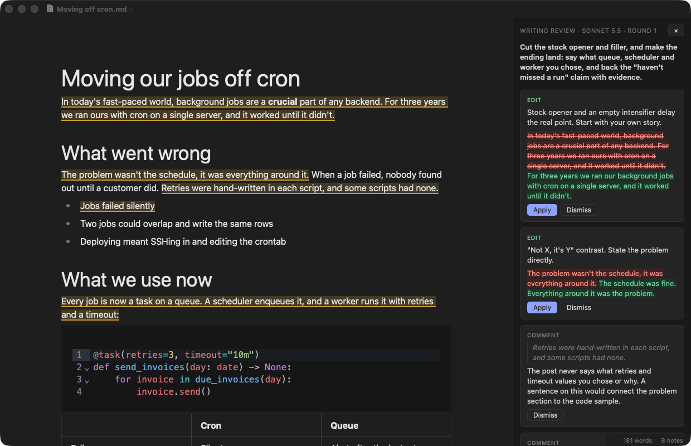
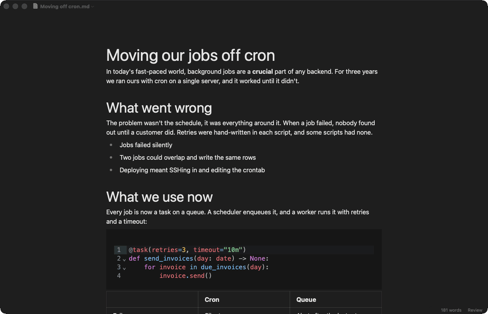

# MD Writer

A native Markdown editor for macOS where you write in the rendered text and Claude reviews the draft for you.

You edit headings, lists, tables and code as they will look, with no split preview. The file on disk stays plain
Markdown. When the draft is ready for a second pair of eyes, Claude reads it in the background and leaves notes in
the margin. Each note is tied to a passage, and suggested edits apply with one click.

## Features

- Live-preview editing: headings, lists, task lists, tables, code blocks with highlighting, and KaTeX math
- Source Code Mode for the raw Markdown (⌘/)
- Headings from the keyboard: ⌘1–⌘6, and ⌘0 for a paragraph
- The usual Mac document features: autosave, versions (File ▸ Revert To…), tabs, recent files, rename and move
- Pasted and dropped images are saved to `assets/` next to the document, and relative image paths just work
- ⌘-click opens links, ⌘+ / ⌘- / ⌥⌘0 zoom, and ⌘P prints or saves a PDF
- Follows the system's light or dark appearance, with a word count in the status bar
- Review by Claude, described below

## Review with Claude

### Before you start

Review runs the [Claude Code](https://claude.com/claude-code) CLI. Install it and sign in, then check that a login
shell finds it: `zsh -lc 'which claude'`. Reviews use your Claude Code account, the same way your own `claude`
sessions do.

### Run a review

1. Choose **Review ▸ Review…** (⇧⌘R), or click **Review** in the status bar.
2. In the sheet, pick a **Reviewer** and a **Model**. **Note** is optional and is passed to Claude with the draft,
   e.g. "for a non-technical audience" or "only check the intro".
3. Click **Review**. The status bar shows the elapsed time, and **✕** next to it cancels. A review takes from 10
   seconds to a minute.

### Work through the notes

The notes open in a panel on the right, and the passage each note refers to is underlined in the text. Click an
underline to jump to its note.

- **Edit** notes show the change as strikethrough and its replacement. **Apply** makes the change in your text.
- **Comment** notes point out a problem without rewriting it for you.
- **Question** notes ask for something only you know, such as a missing fact. Reviewers are told to ask instead of
  inventing numbers, names or claims.
- **Dismiss** removes a note you disagree with.

If you change an underlined passage yourself, its note says "This text changed after the review" and can only be
dismissed, so Apply never overwrites your own edit.

### Further rounds

**Review ▸ Review Again** (⌥⌘R) continues the same Claude session. It sends the current draft and says which notes
you applied, dismissed or left open, so the reviewer doesn't repeat itself. **Start Fresh Review…** starts a new
session, and so does picking a different reviewer.

### Reviewers

Each reviewer is a Claude Code skill bundled with the app in `skills/`:

- **Writing review**: written for MD Writer. It checks structure, then substance, then wording and stock phrases.
- **[Clarity](https://github.com/addyosmani/clarity)** by Addy Osmani (MIT).
- **[Plain writing](https://github.com/docwriter-org/plain-writing-skill)** by Shreya Shankar (MIT).

To add your own, put a skill folder with a `SKILL.md` in `skills/` and rebuild. To use a bundled reviewer in your own
Claude sessions, link it: `ln -s "$PWD/skills/writing-review" ~/.claude/skills/`.

### What Claude can see

MD Writer sends the draft and your note to `claude -p`. Claude runs in its own folder
(`~/Library/Application Support/MD Writer/Review`) that holds only the chosen skill, and gets two tools: loading the
skill and reading files. It can't edit files or run commands, and your draft changes only when you click Apply. The
panel header shows the exact model that wrote the notes.

## Build

Requires macOS 14 or later, Swift (Xcode command line tools) and [bun](https://bun.sh).

    ./scripts/build-app.sh
    open "dist/MD Writer.app"

The app icon is drawn in `Resources/AppIcon.svg`. After editing it, regenerate `Resources/AppIcon.icns` with
`uv run scripts/make-icon.py`.

## How it's built

A native AppKit `NSDocument` app hosts a `WKWebView` that runs the editor, with one script message handler as the
bridge between them. The editor is [Milkdown Crepe](https://milkdown.dev) (ProseMirror, with CodeMirror for code
blocks). The Swift side owns files, menus and the review process. The web side owns editing and the notes panel.

- `Sources/MDWriter/`: the app, documents, menus and `Review.swift` (runs `claude -p` and parses its output)
- `web/src/`: the editor (`editor.ts`), the notes panel (`review.ts`) and quote anchoring (`anchor.ts`)
- `skills/`: the bundled reviewers

Tests for the web side run with `cd web && bun run test`.

## License

[MIT](LICENSE). The bundled Clarity and plain-writing skills keep their own MIT licenses in their folders.
